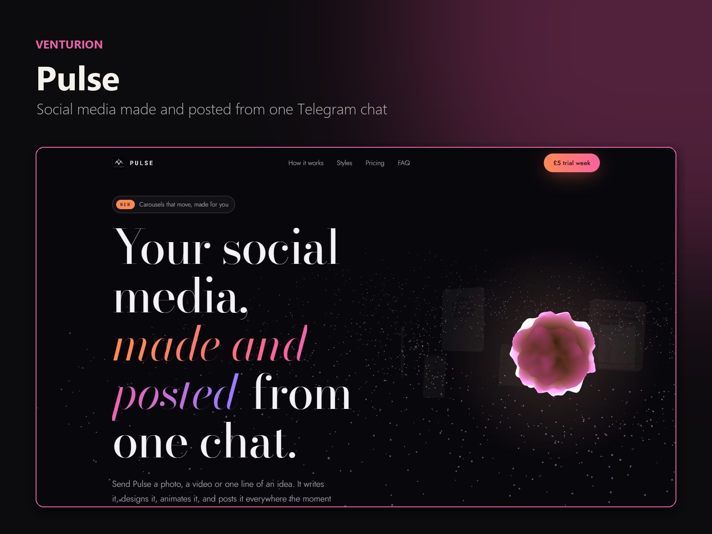
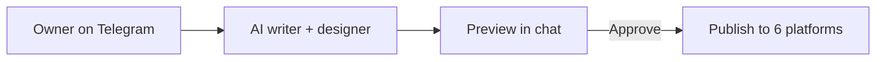
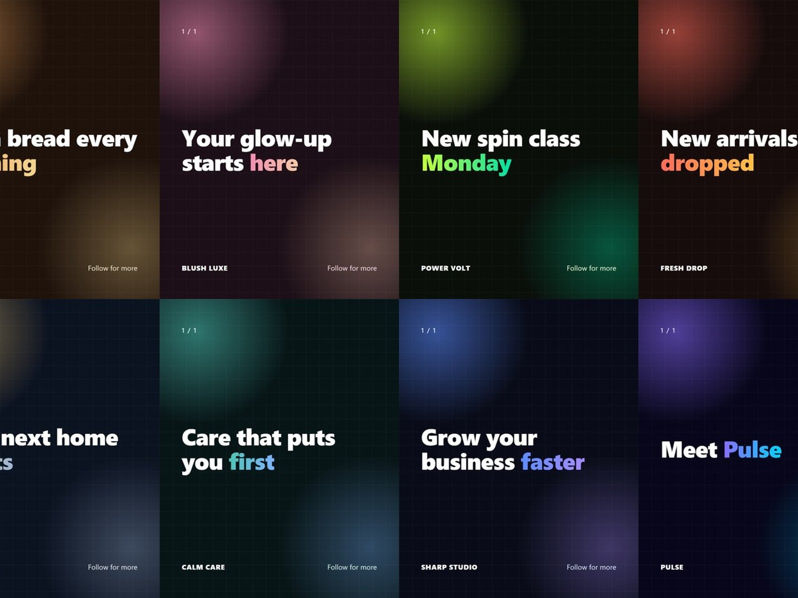

# Pulse - social media made and posted from one chat

**Live:** https://venturionai.com/pulse/

Small businesses send Pulse a photo, a video or one line of an idea on Telegram. It writes it, designs it, animates it, and posts it everywhere the moment they tap Approve.

## What it does
- Writes captions in the business's voice (modes for jewellers, cafes, salons and more)
- Designs posts and carousels in a brand style kit; places product photos on AI studio backgrounds
- Publishes to Instagram, Facebook, TikTok, YouTube, X and LinkedIn
- Analytics, billing and an HQ dashboard

## How it works

## Built with
Python, python-telegram-bot, Claude, fal.ai, SQLite, Stripe; runs as a service with auto-restart and a watchdog. 460+ commits, 117 test files.

## Screenshots

## About this repository
This is a showcase: what the product does, how it is built and what it looks like. The source code is private. Want something like this for your business? Book a 15-minute call: https://cal.com/haroon-younis-p9tjo5/intro - or visit https://venturionai.com

Built by **VENTURION**, an AI agents & automation studio in London.
